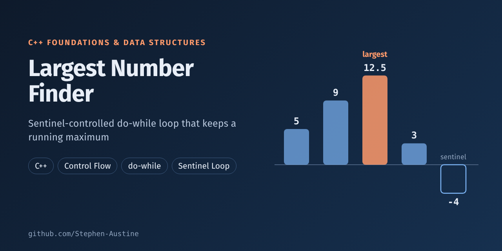
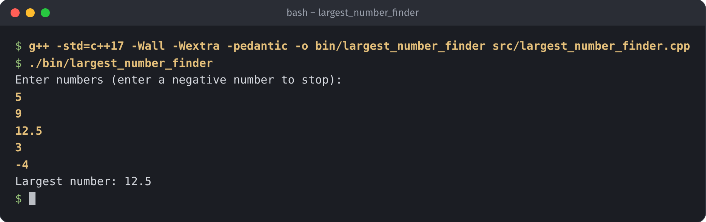
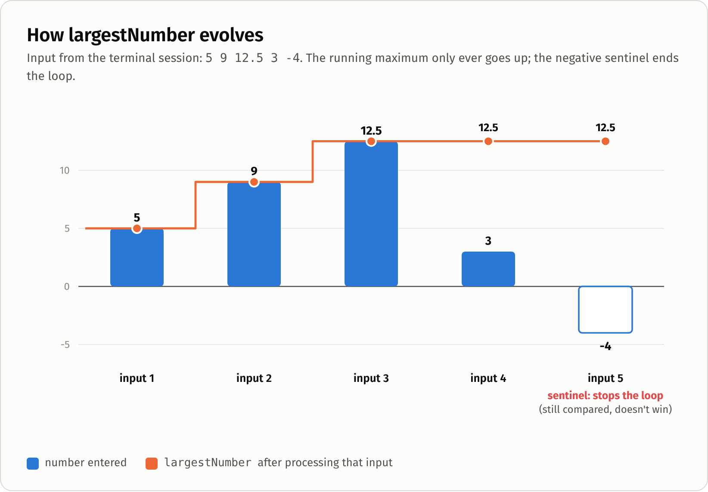
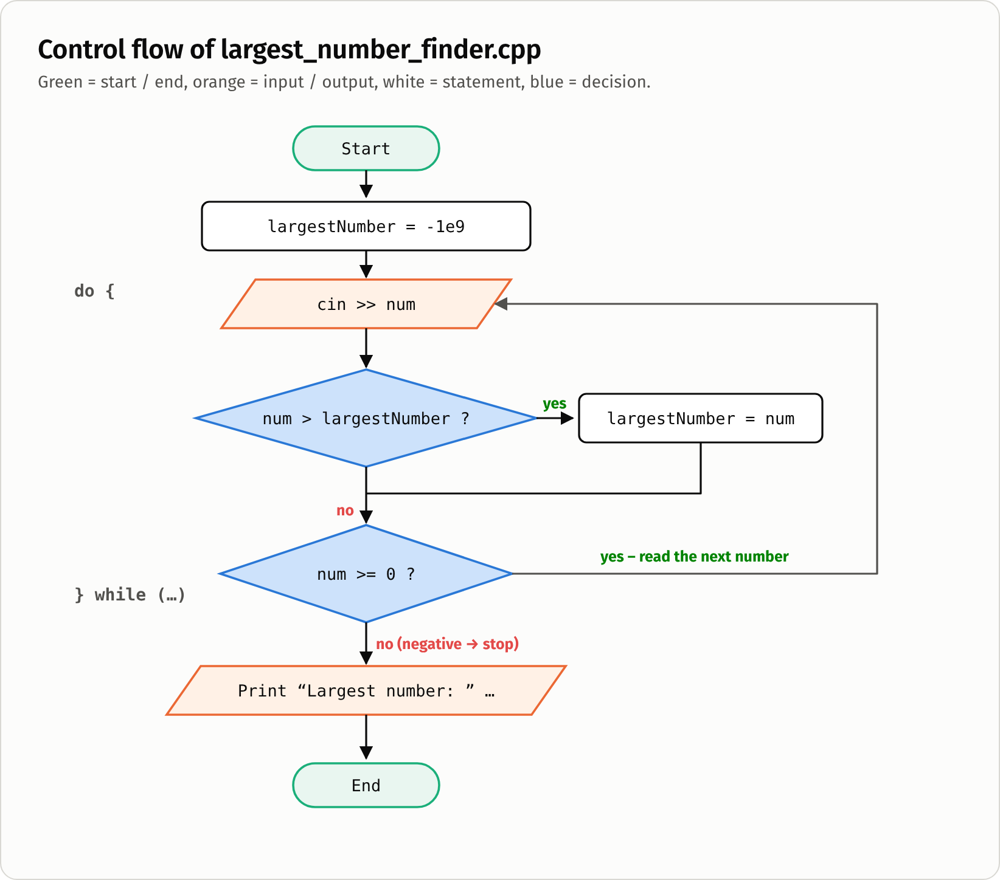
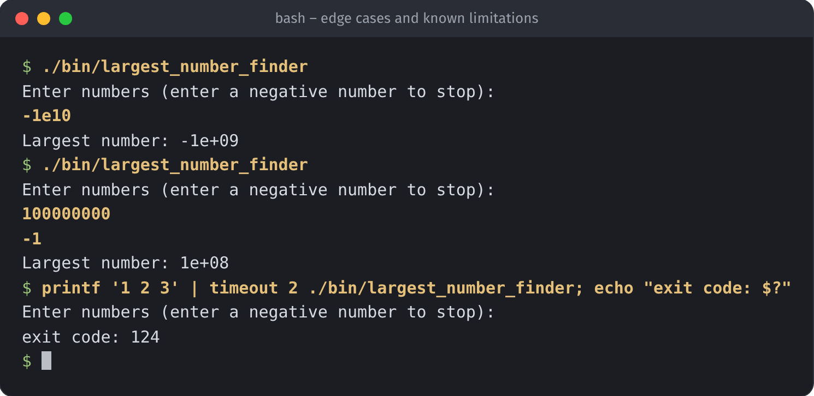

<div align="center">



# C++ Largest Number Finder Using a Sentinel-Controlled Do-While Loop

**A beginner-friendly C++ console program that reads numbers until you type a negative one and then prints the largest number entered – documented with a running-maximum diagram, flowchart, real terminal captures, tests, and an honest, verified list of pitfalls (including the sentinel that sneaks into the comparison and the input that makes the loop run forever).**

[](https://github.com/Stephen-Austine/CPP-Largest-Number-Finder-Using-Sentinel-Controlled-Do-While-Loop/actions/workflows/ci.yml)


</div>

---

## Table of contents

1. [Overview](#1-overview)
2. [What you will learn](#2-what-you-will-learn)
3. [Demo](#3-demo)
4. [Core concepts: sentinel values, do-while and running maximum](#4-core-concepts-sentinel-values-do-while-and-running-maximum)
5. [Project structure](#5-project-structure)
6. [Getting started](#6-getting-started)
7. [The source code, explained](#7-the-source-code-explained)
8. [Flowchart](#8-flowchart)
9. [Worked examples and edge cases](#9-worked-examples-and-edge-cases)
10. [Complexity analysis](#10-complexity-analysis)
11. [Testing](#11-testing)
12. [Known limitations and pitfalls](#12-known-limitations-and-pitfalls)
13. [Ideas for improving the program](#13-ideas-for-improving-the-program)
14. [Changes made when preparing this repository](#14-changes-made-when-preparing-this-repository)
15. [Practice exercises](#15-practice-exercises)
16. [FAQ](#16-faq)
17. [Related projects](#17-related-projects)
18. [License and author](#18-license-and-author)

---

## 1. Overview

Finding the largest value in a list is one of the first algorithms every programmer learns. This program does it for a list whose length is **not known in advance**: the user keeps typing numbers, and a **negative number** means "that's all".

The algorithm is a single pass:

1. Start with a running maximum that is smaller than anything the user is likely to type (`-1e9`).
2. Read a number.
3. If it is larger than the running maximum, it becomes the new running maximum.
4. If the number was **not negative**, go back to step 2. Otherwise stop.
5. Print the running maximum.

### Highlights

- Pure standard C++ – only `<iostream>`.
- Demonstrates a **`do { … } while (…)`** loop (body runs at least once) and a **sentinel value** (a special input that means "stop").
- Builds warning-free with `-Wall -Wextra -pedantic` on **C++11, 14, 17 and 20**, with both **g++** and **clang++**.
- 9 automated input/output tests plus 4 "known limitation" probes.
- Running-maximum diagram, flowchart and real terminal captures.

---

## 2. What you will learn

- What a **sentinel-controlled loop** is, and how it differs from a counter-controlled loop.
- How a `do-while` loop differs from a `while` loop (the test happens *after* the body).
- The **running maximum** pattern – the same idea behind `std::max_element`, high scores and peak-temperature trackers.
- Why choosing an *initial value* is a design decision with consequences.
- How `cin >> double` behaves on bad input and at end-of-file – and why that can create an **infinite loop**.
- How `cout` formats `double` values by default.
- How to test an interactive program with piped input.

---

## 3. Demo

The user types `5`, `9`, `12.5`, `3` and finally `-4` to stop:

<p align="center">
  
</p>

> The screenshot is a real capture of the compiled program running in a terminal. The values in yellow were typed by the user.

Text version:

```text
Enter numbers (enter a negative number to stop):
5 9 12.5 3 -4
Largest number: 12.5
```

### How the running maximum evolves

<p align="center">
  
</p>

| Step | Number read (`num`) | `num > largestNumber` ? | `largestNumber` after | `num >= 0` ? (continue?) |
|---|---|---|---|---|
| start | – | – | `-1e9` | – |
| 1 | `5` | yes | `5` | yes |
| 2 | `9` | yes | `9` | yes |
| 3 | `12.5` | yes | `12.5` | yes |
| 4 | `3` | no | `12.5` | yes |
| 5 | `-4` | no | `12.5` | **no – stop** |

The terminating `-4` *was* compared against the maximum (step 5), but since it is smaller than `12.5` it changed nothing. This is the subtle part of the design – see [section 12](#12-known-limitations-and-pitfalls) for the case where it does matter.

---

## 4. Core concepts: sentinel values, do-while and running maximum

### 4.1 Sentinel-controlled loops

A **sentinel** is a special value that marks the end of the input. It is chosen from outside the range of valid data. Here valid data is "zero or larger" and the sentinel is "any negative number".

| Loop style | Stops when… | Example |
|---|---|---|
| Counter-controlled | A counter reaches a known count | "read 10 numbers" |
| **Sentinel-controlled** | A special value is read | "read numbers until a negative one" |
| End-of-file-controlled | The input source runs out | `while (cin >> x)` |

### 4.2 `do-while` versus `while`

```cpp
do { body } while (condition);   // body first, test afterwards  -> body runs at least once
while (condition) { body }       // test first                    -> body may never run
```

`do-while` fits here because the program cannot know whether to stop until it has read the first number.

### 4.3 The running-maximum pattern

```text
best = something smaller than every possible value
for each value v:
    if v > best:  best = v
```

Everything depends on the starting value of `best`. This program uses `-1e9` ("minus one billion"). Any value larger than that replaces it immediately. The weakness of this choice is discussed in [limitation 2](#2-the-starting-value--1e9-is-an-arbitrary-floor).

---

## 5. Project structure

```text
CPP-Largest-Number-Finder-Using-Sentinel-Controlled-Do-While-Loop/
├── src/
│   └── largest_number_finder.cpp   # the whole program
├── tests/
│   └── run_tests.sh                # black-box tests: feeds stdin, compares stdout
├── docs/
│   └── images/                     # every figure used in this README
├── .github/
│   └── workflows/ci.yml            # builds + tests on C++11/14/17/20
├── Makefile                        # make | make run | make test | make clean
├── .gitignore
├── LICENSE                         # MIT
└── README.md
```

---

## 6. Getting started

### 6.1 Prerequisites

Any C++11-or-newer compiler:

| Platform | How to get one |
|---|---|
| Linux (Debian/Ubuntu) | `sudo apt install build-essential` |
| macOS | `xcode-select --install` (provides `clang++`) |
| Windows | [MSYS2 / MinGW-w64](https://www.msys2.org/) for `g++`, or Visual Studio's C++ workload |

The test script needs a Bash shell (Linux, macOS, WSL or Git Bash). The program itself does not.

### 6.2 Clone

```bash
git clone https://github.com/Stephen-Austine/CPP-Largest-Number-Finder-Using-Sentinel-Controlled-Do-While-Loop.git
cd CPP-Largest-Number-Finder-Using-Sentinel-Controlled-Do-While-Loop
```

### 6.3 Build and run with `make`

```bash
make          # compiles src/largest_number_finder.cpp  ->  bin/largest_number_finder
make run      # builds (if needed) and starts the interactive program
make test     # builds and runs the automated tests
make clean    # removes bin/
```

Use a different compiler or standard without editing anything:

```bash
make CXX=clang++
make CXXFLAGS="-std=c++11 -Wall -Wextra -pedantic -O2"
```

### 6.4 Build and run without `make`

```bash
mkdir -p bin
g++ -std=c++17 -Wall -Wextra -pedantic -o bin/largest_number_finder src/largest_number_finder.cpp
./bin/largest_number_finder
```

On Windows (MinGW) the executable is `bin\largest_number_finder.exe`. With the Visual Studio developer prompt the equivalent command is `cl /EHsc /std:c++17 src\largest_number_finder.cpp` (the MSVC route has not been tested for this repository; g++ and clang++ have).

### 6.5 Non-interactive use

Numbers can be separated by spaces or newlines, so the program can be fed from a pipe. Remember to end the list with a negative number:

```bash
printf '3 7 2 -1\n' | ./bin/largest_number_finder
# Enter numbers (enter a negative number to stop):
# Largest number: 7
```

> Use `printf -- '-5\n'` (with the `--`) when the first thing you print starts with a minus sign.

---

## 7. The source code, explained

Full file: [`src/largest_number_finder.cpp`](src/largest_number_finder.cpp)

```cpp
#include <iostream>
using namespace std;

int main() {
    double largestNumber = -1e9; // Initialize to negative infinity
    double num;

    cout << "Enter numbers (enter a negative number to stop):\n";
    do {
        cin >> num;
        if (num > largestNumber) {
            largestNumber = num;
        }
    } while (num >= 0);

    cout << "Largest number: " << largestNumber << endl;

    return 0;
}
```

### 7.1 Line-by-line

| Code | Explanation |
|---|---|
| `double largestNumber = -1e9;` | The running maximum. `-1e9` is scientific notation for −1 000 000 000. The comment in the source says "negative infinity", but it is really *a very small number* – see [limitation 2](#2-the-starting-value--1e9-is-an-arbitrary-floor). |
| `double num;` | Holds the number most recently read. It is declared without a value, which is safe here only because `cin >> num` assigns it before it is used. |
| `cout << "Enter numbers (…)\n";` | One prompt, printed once, before the loop. |
| `do {` | Start of the loop; the body always runs at least once. |
| `cin >> num;` | Reads the next whitespace-separated number. It works for `7`, `-3`, `12.5` and `1e3`. |
| `if (num > largestNumber) largestNumber = num;` | The running-maximum update. Notice it runs **for every number, including the final negative one**. |
| `} while (num >= 0);` | Loop test, evaluated after the body. `0` and every positive number continue the loop; any negative number ends it. |
| `cout << "Largest number: " << largestNumber << endl;` | Prints the result with default formatting (6 significant digits). `endl` ends the line and flushes the stream. |
| `return 0;` | Reports success to the operating system. |

### 7.2 Why `>=` and not `>` in the loop test?

`while (num >= 0)` means **zero is a valid value**, not a stop signal. Only strictly negative numbers stop the loop. The test `0 -3` confirms that the answer is `0`, not "nothing".

### 7.3 Why `double` instead of `int`?

`double` accepts both whole numbers and decimals (`12.5`), and it has a much wider range than `int`. The price is that results are printed with `cout`'s default floating-point formatting (see [limitation 5](#5-large-results-print-in-scientific-notation)).

---

## 8. Flowchart

<p align="center">
  
</p>

The key observation is that the **update step sits before the loop test**. Every number – even the sentinel – passes through the comparison.

---

## 9. Worked examples and edge cases

All outputs below were produced by running the compiled program.

<p align="center">
  
</p>

| # | Input | Output | What it shows |
|---|---|---|---|
| 1 | `3 7 2 -1` | `Largest number: 7` | Normal use |
| 2 | `5 9 12.5 3 -4` | `Largest number: 12.5` | Decimals are fine |
| 3 | `50 10 20 -1` | `Largest number: 50` | Largest value first |
| 4 | `1 2 3 99 -1` | `Largest number: 99` | Largest value last |
| 5 | `4 4 4 -1` | `Largest number: 4` | Ties are harmless |
| 6 | `0 -3` | `Largest number: 0` | Zero counts as data |
| 7 | `8⏎3⏎-2⏎` | `Largest number: 8` | Newlines work like spaces |
| 8 | `10 -2000000000` | `Largest number: 10` | The sentinel never beats real data |
| 9 | `-5` | `Largest number: -5` | **Only a sentinel entered:** the sentinel itself is reported |
| 10 | `-1e10` | `Largest number: -1e+09` | Masked by the starting value |
| 11 | `100000000 -1` | `Largest number: 1e+08` | Scientific notation |
| 12 | `1234567.89 -1` | `Largest number: 1.23457e+06` | Only 6 significant digits |
| 13 | *(empty input / Ctrl-D)* | *(never finishes)* | EOF causes an infinite loop |
| 14 | `5 abc` | *(never finishes)* | Bad input causes an infinite loop |

---

## 10. Complexity analysis

| Measure | Value | Explanation |
|---|---|---|
| **Time** | O(n) | One comparison per number entered; `n` is the count of numbers including the sentinel |
| **Space** | O(1) | Two `double` variables; the numbers themselves are **not stored** |

Because the program remembers only the maximum, it works for an input of any length – a million numbers use the same memory as three.

---

## 11. Testing

### 11.1 Running the tests

```bash
make test
```

Expected output:

```text
largest_number_finder tests
  PASS  ascending then sentinel
  PASS  largest in the middle (decimal)
  PASS  largest is the first value
  PASS  largest is the last value
  PASS  all values equal
  PASS  zero is a valid value, not a stop signal
  PASS  only a sentinel entered
  PASS  numbers may be split over lines
  PASS  very small sentinel after data

Known limitations (not counted as failures):
  CONFIRMED  a first value below -1e9 is masked by the -1e9 starting value
  CONFIRMED  large results print in scientific notation (1e+08)
  CONFIRMED  input that ends (EOF) without a negative number loops forever (killed by timeout)
  CONFIRMED  non-numeric input loops forever (killed by timeout)

9 passed, 0 failed
```

### 11.2 How the tests work

`tests/run_tests.sh` pipes input to the program through `printf`, runs it under `timeout 5`, and compares **the complete output** with the expected text, byte for byte:

```bash
check "largest in the middle (decimal)" '5 9 12.5 3 -4\n' "${PROMPT}Largest number: 12.5
"
```

The `timeout` matters: without it, the two infinite-loop probes would hang the test run forever.

### 11.3 What is covered

| Category | Cases |
|---|---|
| Position of the maximum | First, middle, last |
| Duplicates | All values equal |
| Decimals | `12.5` |
| **Boundary** | `0` is data, not a stop signal |
| Sentinel behaviour | Only a sentinel; a very small sentinel after data |
| Input layout | Numbers across several lines |

The four "known limitation" probes are **reports**, not pass/fail tests. They confirm that the behaviours described in the next section are real, and print `CHANGED` if a future edit alters them.

### 11.4 Continuous integration

`.github/workflows/ci.yml` runs `make test` on every push and pull request for C++11, 14, 17 and 20 with `-Wall -Wextra -pedantic`.

---

## 12. Known limitations and pitfalls

Every item below was reproduced by running the program.

### 1. The sentinel takes part in the comparison

The update `if (num > largestNumber)` runs *before* the loop test, so the final negative number is compared too. When at least one non-negative number was entered this never matters (a negative number cannot beat a non-negative one). When the **first** number is the sentinel it does:

| Input | Output | Expected by most people |
|---|---|---|
| `-5` | `Largest number: -5` | "no numbers entered" |

The program reports the sentinel as if it were data.

### 2. The starting value `-1e9` is an arbitrary floor

The comment says "negative infinity", but `-1e9` is just a number. Any first value smaller than it is never picked up:

| Input | Output |
|---|---|
| `-1e10` | `Largest number: -1e+09` – the program reports its own starting value, not anything the user typed |

For the intended use (non-negative data ended by a negative sentinel) this cannot matter, because every real value is ≥ 0. It would matter if the program were adapted to accept negative data.

### 3. End-of-file causes an infinite loop

If the input ends without a negative number – the user presses **Ctrl-D** (Linux/macOS) or **Ctrl-Z** (Windows), or a pipe closes – `cin >> num` fails and leaves `num` unchanged. Nothing in the loop checks for that, and `num >= 0` stays true if the last value was non-negative, so the loop repeats forever. In the tests this is killed by `timeout` (exit status 124).

### 4. Non-numeric input causes an infinite loop

Typing a word such as `abc` puts `cin` into a failed state. The failed read sets `num` to `0` (C++11 and newer), every later `cin >> num` does nothing, `num >= 0` stays true and the loop never ends:

```text
Enter numbers (enter a negative number to stop):
5 abc
█            ← never returns
```

### 5. Large results print in scientific notation

`cout` shows `double` with 6 significant digits. `100000000` prints as `1e+08`, and `1234567.89` prints as `1.23457e+06` – losing digits. Use `cout << fixed << setprecision(2)` (from `<iomanip>`) or `setprecision(17)` to see more.

### 6. Nothing is said when no real number was entered

The program prints a result even if the user entered no data at all (limitation 1). There is no "empty list" message.

### 7. Result of the loop depends on `double` range

Numbers beyond about 1.8 × 10³⁰⁸ cannot be represented. `cin` treats such input (for example `1e309`) as a failure, which leads to limitation 4 – confirmed: `5 1e309 -1` never finishes.

---

## 13. Ideas for improving the program

> These snippets are **suggestions**, not part of the repository's source. The complete snippet below was compiled with `g++ -std=c++17 -Wall -Wextra -pedantic` and run.

### 13.1 Fix limitations 1–4 at once

```cpp
#include <iostream>
#include <limits>

int main() {
    double largest = std::numeric_limits<double>::lowest();
    double num;
    bool any = false;

    std::cout << "Enter numbers (enter a negative number to stop):\n";
    while (std::cin >> num && num >= 0) {
        if (!any || num > largest) { largest = num; any = true; }
    }

    if (any) std::cout << "Largest number: " << largest << '\n';
    else     std::cout << "No non-negative numbers were entered.\n";
}
```

What changed and why:

| Change | Fixes |
|---|---|
| `while (std::cin >> num && num >= 0)` – test *after reading, before using* | The sentinel never reaches the comparison (limitation 1); a failed read ends the loop (limitations 3 and 4) |
| `bool any` flag, first value always accepted | No dependency on a "very small" starting value (limitation 2) |
| `numeric_limits<double>::lowest()` | The real smallest `double`, if you still want an initial value |
| Explicit "nothing entered" message | Limitation 6 |

Verified results: `3 7 2 -1` → `Largest number: 7`; `-5` → `No non-negative numbers were entered.`; empty input → the same message and the program **terminates**.

### 13.2 Allow negative data with a different stop signal

If negative numbers should be valid data, choose another sentinel – for example the word `done`:

```cpp
#include <iostream>
#include <string>

int main() {
    std::string token;
    double largest = 0;
    bool any = false;
    while (std::cin >> token && token != "done") {
        double v = std::stod(token);   // throws on non-numbers – catch it in real code
        if (!any || v > largest) { largest = v; any = true; }
    }
    if (any) std::cout << "Largest: " << largest << '\n';
}
```

### 13.3 More ideas

- Track the **smallest** number, the **sum** and the **average** in the same pass.
- Count how many numbers were entered.
- Remember *which position* held the maximum.
- Store the numbers in a `std::vector<double>` and use `std::max_element`.
- Print with `std::fixed` and `std::setprecision(2)`.
- Wrap the logic in a function `double largest(std::istream&)` so it can be unit-tested without a terminal.

---

## 14. Changes made when preparing this repository

The original was an RTF (rich text) file, `biggest_Number.rtf`. It was converted to a real C++ source file.

| Change | Reason |
|---|---|
| RTF converted to plain `.cpp` | A source file must be plain text to compile. |
| Descriptive header comment added | Documents purpose, algorithm and build command. |
| File renamed `biggest_Number.rtf` → `src/largest_number_finder.cpp` | The name says what the program does; conventional `src/` layout. |
| Repository files added | `README.md`, `Makefile`, `tests/`, `docs/`, CI workflow, `LICENSE`, `.gitignore`. |

The program's logic, prompts and messages are identical to the original.

---

## 15. Practice exercises

1. **Reproduce the bug.** Enter only `-5` and explain, line by line, why it prints `-5`.
2. **Move the check.** Rewrite the loop so the sentinel never enters the comparison, without changing the output of normal runs.
3. **Add a minimum.** Print the smallest non-negative number too.
4. **Add statistics.** Print the count, sum and average.
5. **Handle end-of-file.** Make Ctrl-D end the input cleanly instead of looping forever.
6. **Reject bad input.** If the user types a word, print a message, clear the error with `cin.clear()` and `cin.ignore(...)`, and carry on.
7. **Accept negatives.** Change the stop signal to the word `done` and test with negative data.
8. **Use the standard library.** Collect the numbers in a `std::vector` and compare your answer with `std::max_element`.
9. **Remove the magic number.** Replace `-1e9` with `numeric_limits<double>::lowest()` and observe what changes in the `-1e10` test.
10. **Port the tests.** Add a test for every fix you make and watch the corresponding "known limitation" probe report `CHANGED`.

---

## 16. FAQ

**Why does entering `0` not stop the program?**
The loop continues while `num >= 0`, so zero is valid data. Only negative numbers stop it.

**Why is the negative number I typed to stop never shown?**
It is read and compared, but because every real value (≥ 0) is at least as large, it never wins. The one exception is when it is the *only* thing entered – see [limitation 1](#1-the-sentinel-takes-part-in-the-comparison).

**Why is `-1e9` used as the starting value?**
It is a convenient "very small" number. A more robust choice is `std::numeric_limits<double>::lowest()` or a flag that says "no value yet" – see [13.1](#131-fix-limitations-14-at-once).

**Can I enter all the numbers on one line?**
Yes. `cin` treats spaces and newlines identically: `5 9 12.5 3 -4` works.

**Why does my program hang?**
Almost certainly because it reached end-of-file or read something that is not a number. See limitations [3](#3-end-of-file-causes-an-infinite-loop) and [4](#4-non-numeric-input-causes-an-infinite-loop). Press Ctrl-C to stop it.

**What is the difference between `do-while` and `while` here?**
With `while (num >= 0)` you would need a value of `num` *before* the first test, so you would have to read a number before the loop and again inside it. `do-while` lets you read once, inside the loop.

**Why does 100000000 print as 1e+08?**
`cout` prints `double` with 6 significant digits by default and uses scientific notation for large numbers. See [limitation 5](#5-large-results-print-in-scientific-notation).

---

## 17. Related projects

This repository is one of five small C++ foundations projects:

| Project | Topic |
|---|---|
| [Linear Queue](https://github.com/Stephen-Austine/CPP-Linear-Queue-Array-Based-Implementation-with-Enqueue-and-Dequeue) | Array-based FIFO, overflow/underflow |
| [Circular Queue](https://github.com/Stephen-Austine/CPP-Circular-Queue-Array-Based-Implementation-with-Wraparound-Indexing) | Wrap-around indexing, counter for full/empty |
| [Binary Search](https://github.com/Stephen-Austine/CPP-Binary-Search-on-Sorted-Vector-with-Interactive-User-Input) | O(log n) search on a sorted vector |
| [Customer Credit Check](https://github.com/Stephen-Austine/CPP-Customer-Credit-Limit-Purchase-Validation-Console-Program) | Loops, input and conditional validation |
| **This repo** – Largest Number Finder | Sentinel-controlled `do-while` loop |

---

## 18. License and author

Released under the [MIT License](LICENSE).

Author: **Stephen Austine** – [github.com/Stephen-Austine](https://github.com/Stephen-Austine)

If this helped you learn something, consider giving the repository a ⭐.
